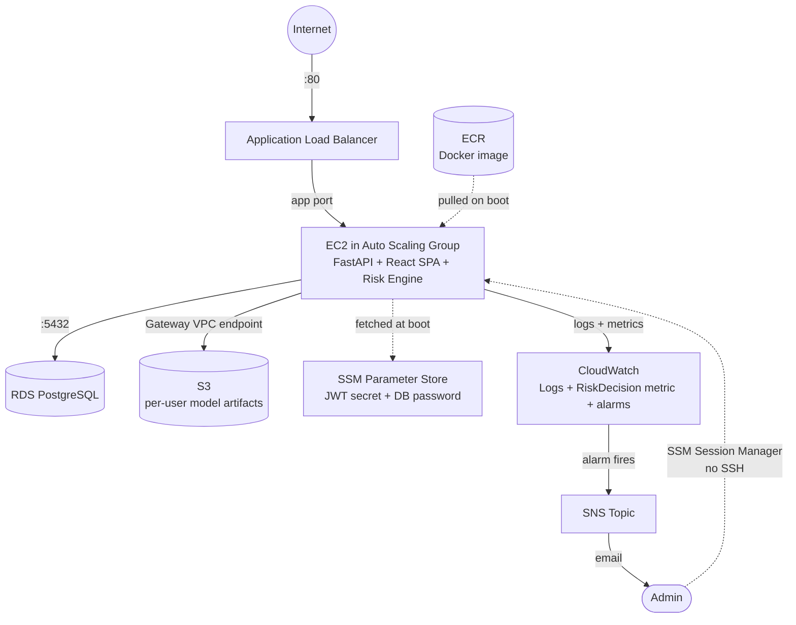

# Cloud Services Used

This project is built on **AWS**, deployed via Terraform (`infra/`). Every
service below is provisioned by a specific Terraform module, so "why it's
here" maps directly to code, not just a diagram.

## Architecture flow



Every hop only trusts the one immediately before it — internet → ALB → app →
DB — which is the same "never trust, always verify" principle applied to the
infrastructure, not just the application logic.

## Services table

| Service | Role | Why it's here | Terraform module |
|---|---|---|---|
| **VPC** (public + private subnets, 2 AZs) | Networking | Isolates the internet-facing tier from the database tier | `infra/modules/network` |
| **EC2 + Auto Scaling Group** | Compute | Runs the app container; demonstrates horizontal scaling | `infra/modules/compute` |
| **Application Load Balancer** | Traffic distribution | Fronts the ASG, health-checks `/health` | `infra/modules/compute` |
| **RDS (PostgreSQL)** | Managed database | Users, behavior samples, sessions, risk-event audit log | `infra/modules/database` |
| **S3** | Object storage | Per-user trained risk-model artifacts (`ModelStore` abstraction), reached via a free Gateway VPC endpoint (no NAT needed) | `infra/modules/storage` |
| **ECR** | Container registry | Holds the built app Docker image, pulled by EC2 on boot | `infra/modules/compute` |
| **IAM** (role + least-privilege policy) | Security | Instance can only touch its own S3 bucket, 2 SSM params, and its own CloudWatch log group | `infra/modules/iam` |
| **SSM Parameter Store** (SecureString) | Secrets | JWT signing secret + DB password, fetched at boot, never baked into the image | `infra/main.tf` |
| **SSM Session Manager** | Admin access | No SSH keys, no open port 22, no bastion host | (IAM policy in `infra/modules/iam`) |
| **CloudWatch** (Logs, custom metric, alarms) | Monitoring | App logs + a custom `RiskDecision` metric + an alarm on risk-engine terminations | `infra/modules/monitoring` |
| **SNS** | Alerting | Email notification when a CloudWatch alarm fires | `infra/main.tf` |

## Deliberately not used

- **NAT Gateway** — always-on cost with no free tier. App instances sit in a
  public subnet instead, locked down by a security group that only allows
  the ALB in.
- **Bastion host / SSH** — replaced entirely by SSM Session Manager, so
  there's no open port 22 and no key management.

## Cost awareness

Everything here fits comfortably in typical AWS free-tier limits **except**
the ALB (hourly + LCU charges) and the RDS instance beyond its 12-month
free-tier window. Don't run `terraform apply` until you're ready for that,
and run `terraform destroy` between demo/grading sessions to avoid ongoing
charges.

## Deploying

```bash
cd infra
terraform init
terraform apply -target=module.compute.aws_ecr_repository.app   # ECR repo first
# build + push the Docker image to that repo (see repo README), then:
cp terraform.tfvars.example terraform.tfvars   # set alert_email at minimum
terraform apply
terraform output alb_dns_name                  # open this URL
terraform destroy                              # when done, to stop charges
```
